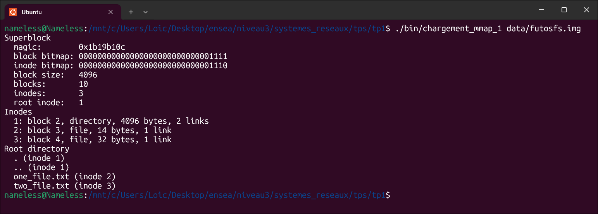
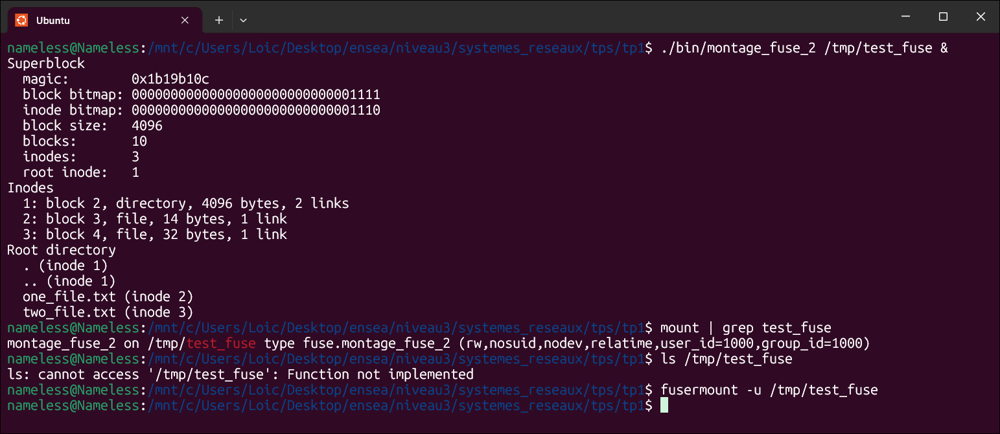
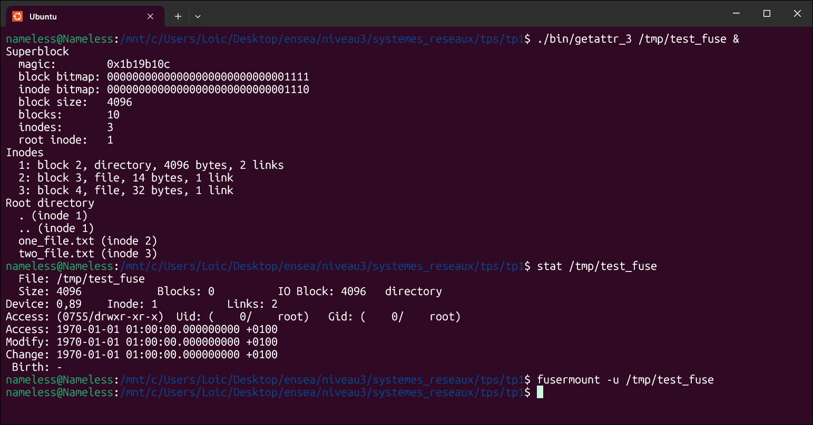
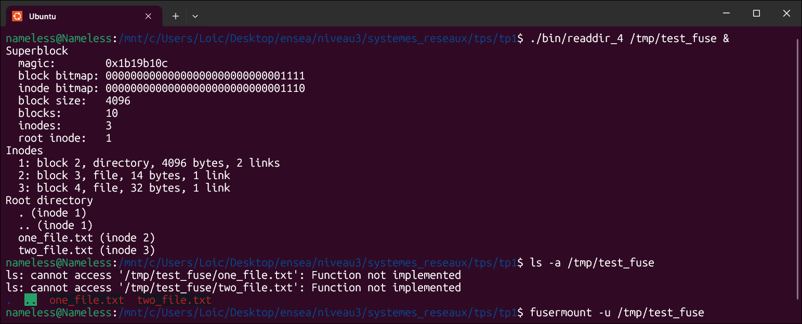
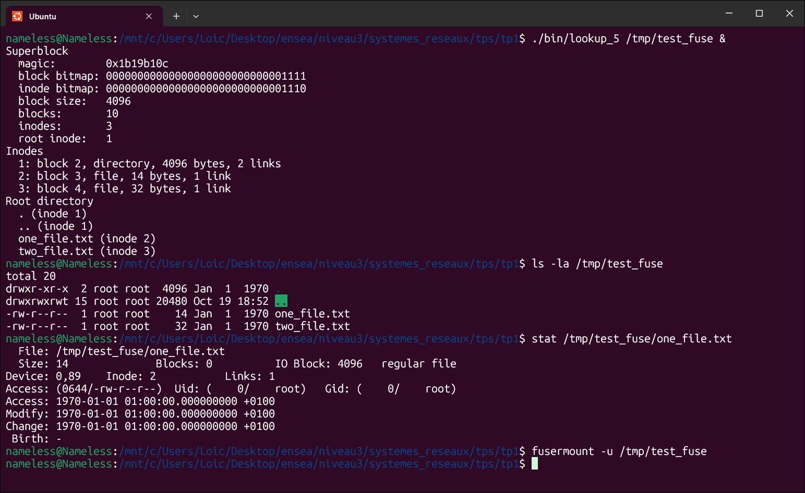
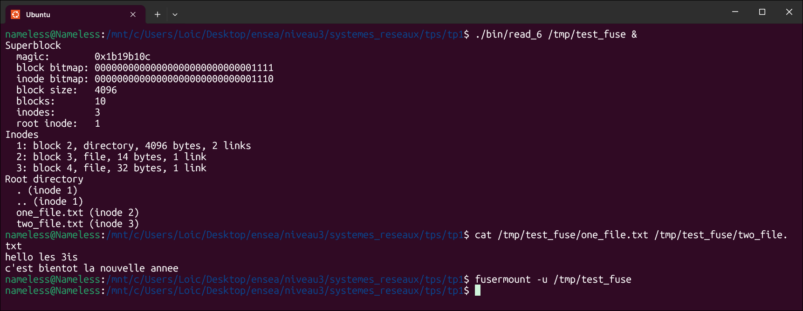
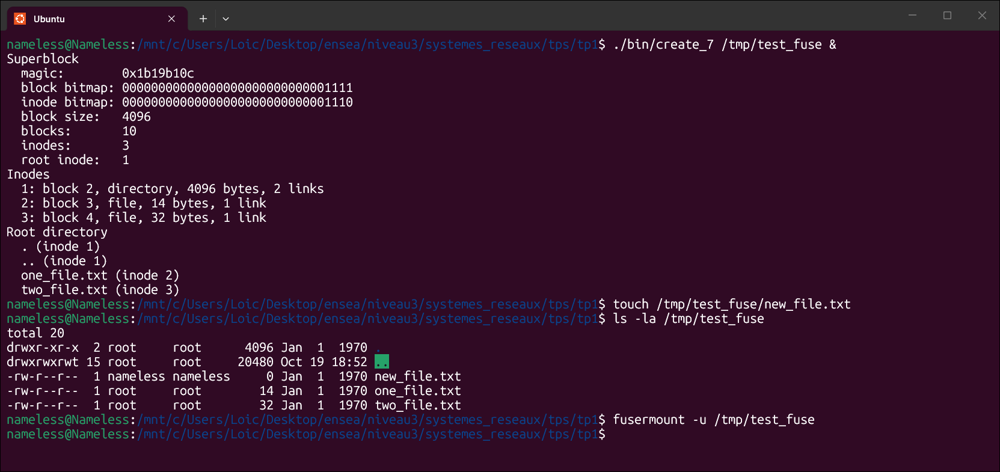
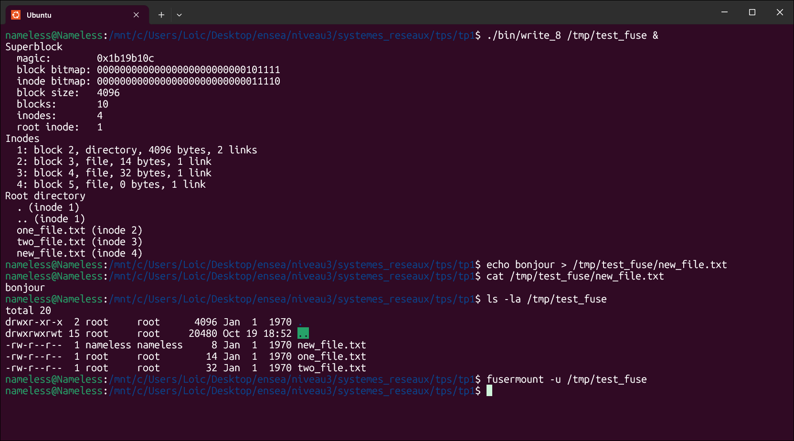

# TP3: Réalisation d’un Système de Fichiers simple

```bash
make
cp data/test_tosfs_files data/futosfs.img
mkdir -p /tmp/test_fuse
```

## Question 1



## Question 2



## Question 3



## Question 4



## Question 5



## Question 6



## Question 7



## Question 8


