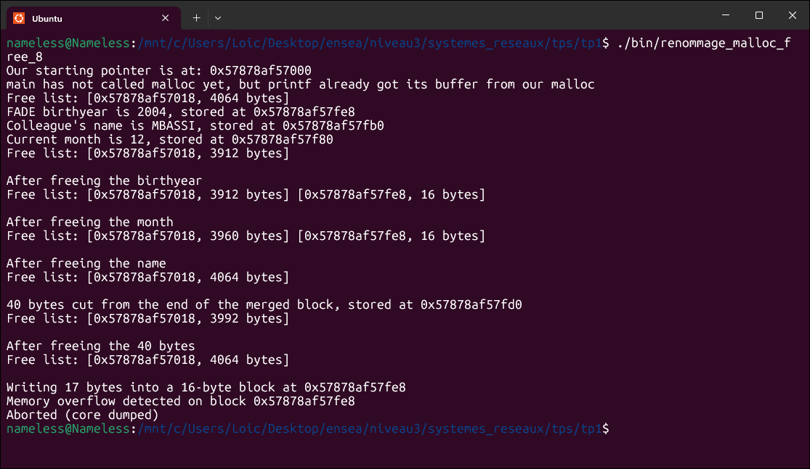

# TP2: secure memory allocator

ENSEA 3rd year (IS), Systèmes et Réseaux.

## Build

```bash
make
```

Each `src/*.c` builds into `bin/<name>`, one file per question.

## printf on top of our malloc (question 8)



`main` has not called `malloc` yet, but the free list already holds a 4064-byte block: `printf` allocated its output buffer with our `malloc`, and its output is displayed. In question 7, the same check shows an empty free list, because `printf` still used the glibc `malloc`.
